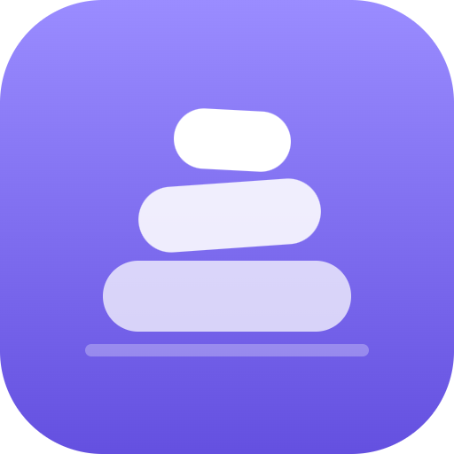
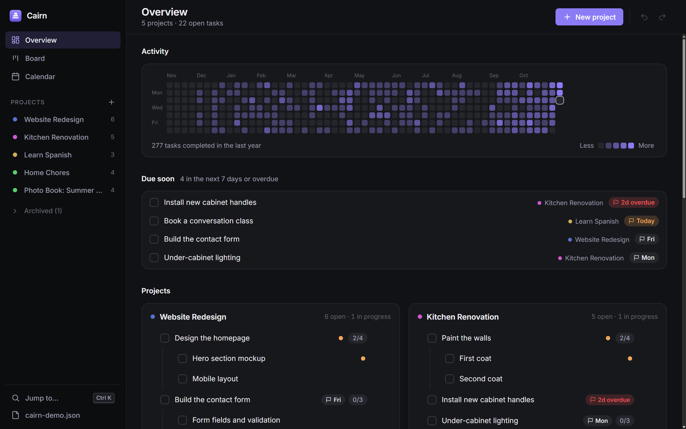
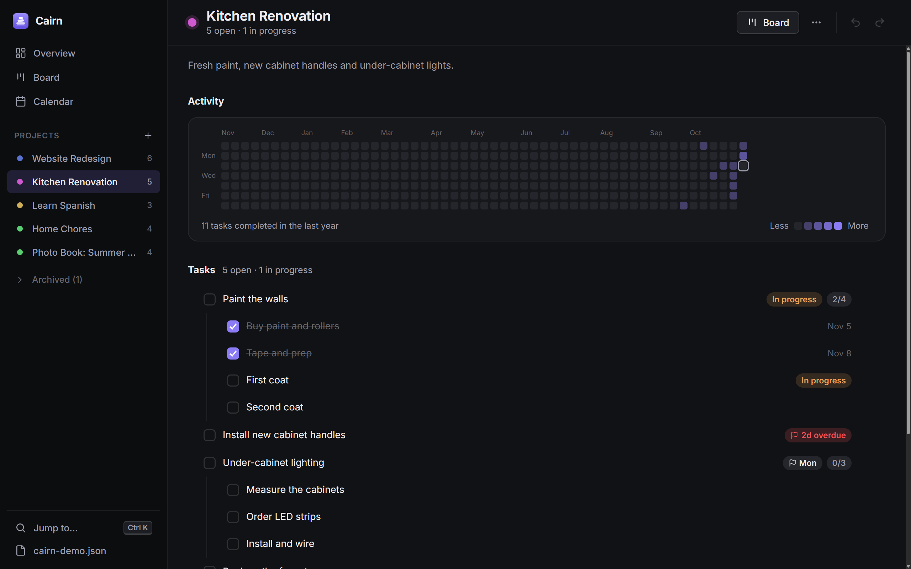
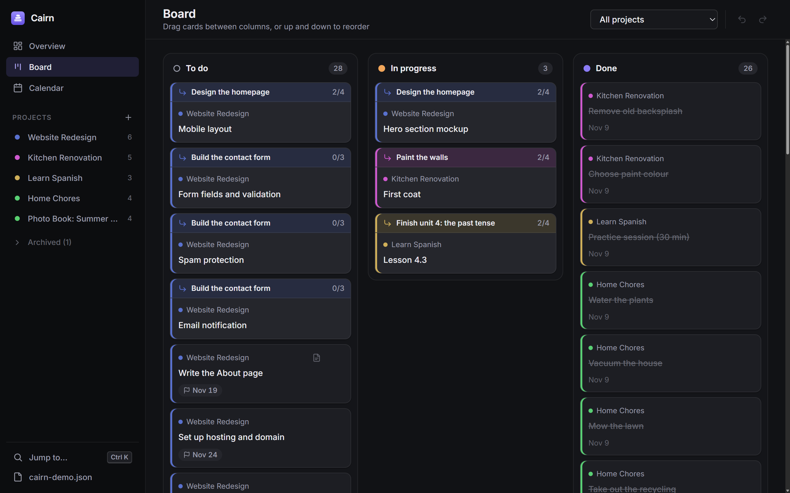
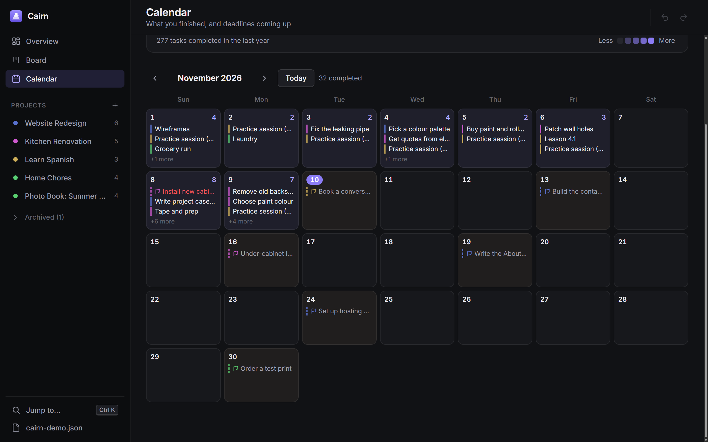
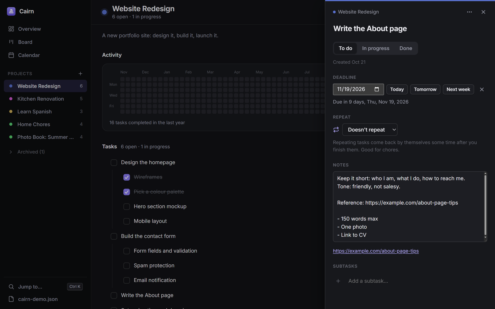
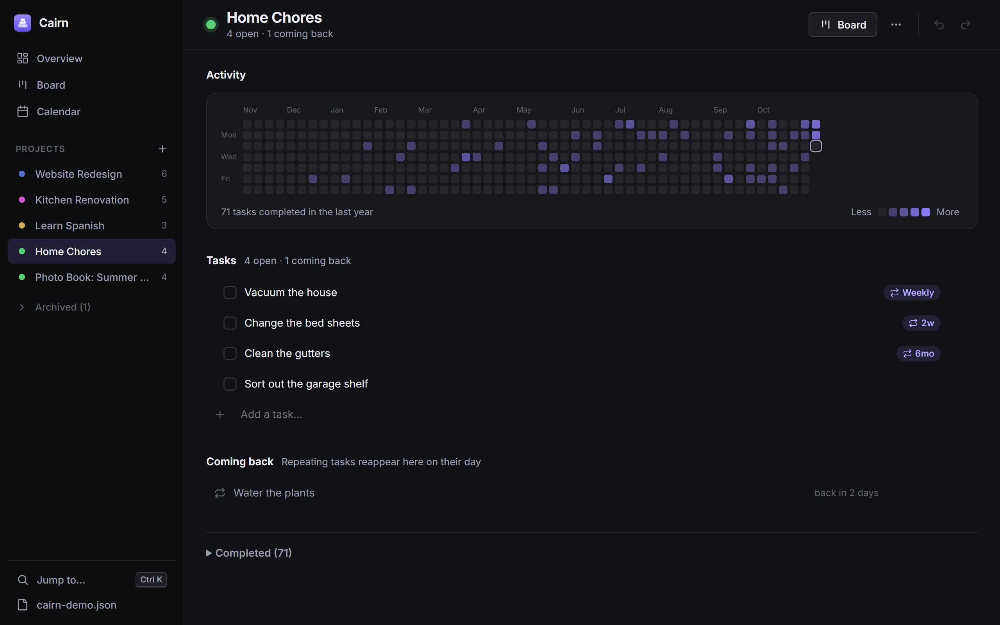
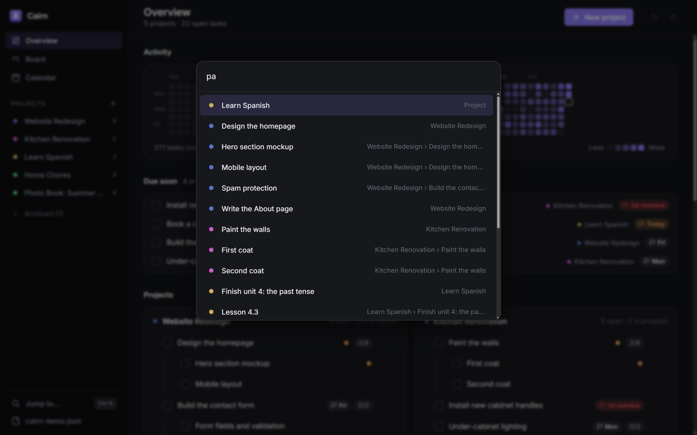
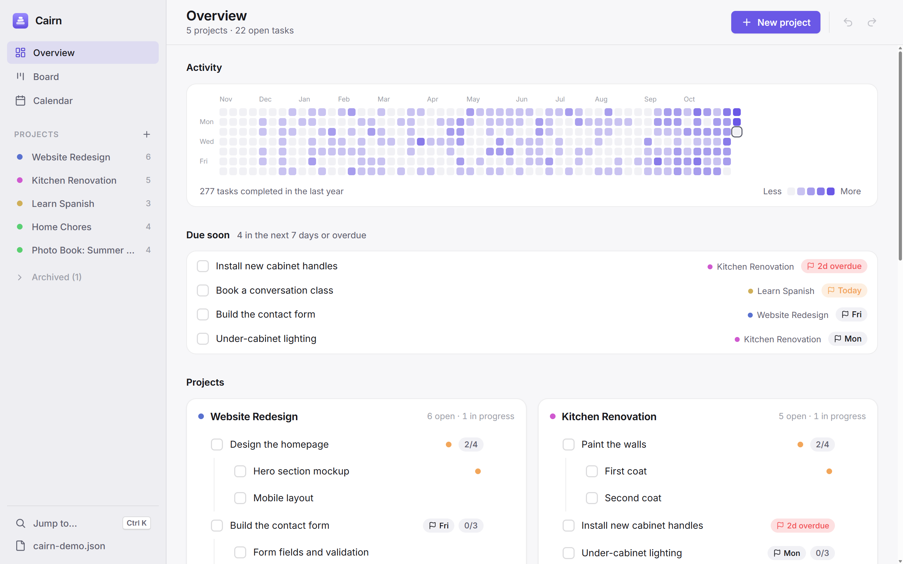

<p align="center">
  
</p>

<h1 align="center">Cairn</h1>

<p align="center">
  <b>A calm, offline project and task tracker that keeps everything in one file you own.</b><br>
  Projects, subtasks, a kanban board, repeating chores, optional deadlines,<br>
  and a GitHub-style activity grid of everything you've finished.
</p>

<p align="center">
  Windows · Linux · Free and open source (MIT)
</p>



---

## Why Cairn?

A cairn is a pile of stones that hikers add to one at a time, to mark the trail and show how far they've come. Cairn works the same way. Every task you finish is another stone, and the activity grid shows the path behind you.

It's built for the projects in a normal life: a game you're making, a website, a kitchen renovation, learning a language, the weekly chores. That means:

- **No account, no server, no sync service.** All your projects live in a single JSON file that you choose, for example `D:\Cairn\projects.json` or a folder on a USB stick. Open the same file from Windows and Linux, or copy it to another computer, and carry on where you left off.
- **No pressure by default.** Tasks have no deadlines unless you add one.
- **One quick app.** There's no web stack to run, and it works without the internet.

## Features

### Projects of any kind, with nested subtasks

Create a project for anything and add tasks to it. Split a big task into subtasks, and those into more subtasks. When the last subtask is ticked, its parent completes automatically. Finished tasks are archived with the date you completed them.



### A kanban board for the work in progress

Drag cards between **To do**, **In progress** and **Done**, or up and down to reorder. A task that has been split up shows its subtasks as cards instead. Each one carries a coloured bar naming its parent task, so you always know what it belongs to. View all projects at once, or one at a time.



### Activity grid and calendar

Every project has a GitHub-style grid of the days you completed tasks, and the overview has one for everything combined. The calendar shows what you finished each day and the deadlines coming up. Click a day to see the details.



### Task details: notes, deadlines, repeats

Click a task to open its details panel. There you can rename it, set its status, write notes (links become clickable), add an optional deadline, make it repeat, and manage its subtasks.



### Repeating tasks for the things that come back

Set a task to repeat daily, weekly, every 3 months, or on any custom interval. When you complete it, a fresh copy waits under **Coming back** and reappears on its day. Repeating tasks still have no due dates; they just return. **Bring back now** skips the wait.



### Optional deadlines

Give any task a deadline, but only if you want one. Tasks with a deadline show badges such as *Today*, *Fri* or *2d overdue*. The overview gathers everything due this week under **Due soon**, and the calendar marks deadlines on their days.

### Fast to use

- **Ctrl+K** jumps to any project, task or view.
- **Undo and redo** for every change (Ctrl+Z / Ctrl+Y), including deletes and moves.
- **Drag a task** above or below another task to reorder it, onto another task to make it a subtask, or onto a project in the sidebar to move it there.
- **Archive** finished projects to tidy the sidebar. Their history stays in the calendar.



### Light and dark

Cairn follows your system theme.



## Getting started

### Install

**Windows:** download from the [Releases page](https://github.com/remiionline/cairn/releases/latest):
- `Cairn-x.y.z-portable.exe` runs without installing; you can even keep it next to your data file;
- `Cairn-x.y.z-setup.exe` installs Cairn with a Start-menu shortcut.

**Linux:** build it from source (see [Building from source](#building-from-source)). The build produces an `.AppImage` you can run directly and a `.deb` package.

### First launch

1. Choose **Create new data file…** and save it wherever suits you. A drive or folder that all your computers can reach works well.
2. On your other computers, choose **Open existing data file…** and pick the same file. Each computer remembers its own path to it (for example `D:\Cairn\projects.json` on Windows and `/mnt/d/Cairn/projects.json` on Linux).
3. Click **+** next to *Projects* in the sidebar to create your first project, and start typing tasks.

Want to look around first? Run `npm run demo` from the `app` folder to open Cairn on a throwaway copy of the demo data shown in these screenshots.

## Using Cairn

| To… | Do this |
|---|---|
| Add a task | Type in **Add a task…** at the bottom of a project and press Enter. The box stays open for the next one. |
| Add a subtask | Hover a task and click its **Add subtask** button (also on board cards), or use the **⋯** menu or the details panel |
| Complete a task | Tick its checkbox, or drag its card to *Done* on the board |
| Mark work in progress | Drag the card to *In progress*, or use the status buttons in the details panel |
| Open details, notes, deadline, repeat | Click the task's name or its board card |
| Reorder | Drag a task row (grab it anywhere) or a board card up or down |
| Make a task a subtask | Drag it onto the middle of another task |
| Move to another project | Drag it onto the project in the sidebar, or use **⋯** → *Move to…* |
| Undo a mistake | **Ctrl+Z**, or the arrows in the top-right corner, or **Undo** on the toast |
| Reorder projects | Drag them up or down in the sidebar |
| Change a project's colour | Click the coloured dot next to its name, or **⋯** → *Change colour…* |
| Archive a finished project | The project's **⋯** menu → *Archive project* |
| See a day's history | Click a square in any activity grid, or a day in the calendar |

### Keyboard shortcuts

| Keys | Action |
|---|---|
| `Ctrl` `K` or `/` | Jump to a project, task or view |
| `N` | New task in the current project |
| `Shift` `N` | New project |
| `1` `2` `3` | Overview, Board, Calendar |
| `Ctrl` `Z` | Undo |
| `Ctrl` `Y` or `Ctrl` `Shift` `Z` | Redo |
| `Esc` | Close a panel, menu or dialog |
| `?` | Show all shortcuts |

## Your data

Everything lives in the one JSON file you picked. It's plain, readable and yours.

- **Safe to share between computers.** Every change re-reads the file before writing, so edits made on another computer are never overwritten. If the file changes while Cairn is open, it reloads automatically.
- **Hard to lose.** Writes are atomic: a temporary file is written, then renamed into place, so a crash can't leave a half-written file. Before the first change each day, a dated copy is saved to `<name>.backups/` next to the file, and the newest 30 are kept.
- **Gives a clear message instead of guessing.** If the drive isn't connected, Cairn says so and offers **Try again** rather than creating a new, empty file.

<details>
<summary>File format</summary>

```json
{
  "app": "project-dashboard",
  "version": 1,
  "settings": { "boardDoneDays": 7 },
  "projects": [
    {
      "id": "a1b2c3", "name": "Kitchen Renovation", "description": "", "created": "2026-09-20",
      "tasks": [
        { "id": "d4e5f6", "text": "Paint the walls", "status": "doing", "created": "2026-09-20", "completed": null,
          "due": "2026-11-20", "notes": "Two coats.",
          "subtasks": [
            { "id": "g7h8i9", "text": "Buy paint", "status": "done", "created": "2026-09-20", "completed": "2026-11-01", "subtasks": [] }
          ] }
      ]
    }
  ]
}
```

- `status` is `todo`, `doing` (In progress) or `done`. Completed top-level tasks form a project's archive.
- These fields are optional and only written when used:
  - on a task: `notes`, `due`, `repeat` (`{ "every": 7, "unit": "day" | "week" | "month" }`);
  - on a project: `archived: true`;
  - on a waiting repeat copy: `waitUntil` and `repeatFrom`.
- The `"app": "project-dashboard"` marker comes from the app's original name and is kept, so older files still open.

</details>

## Building from source

You need [Node.js](https://nodejs.org) 20 or newer.

```bash
git clone https://github.com/remiionline/cairn.git
cd cairn/app
npm ci
npm start                # build and run
```

| Command (in `app/`) | What it does |
|---|---|
| `npm start` | Build and run the app |
| `npm run demo` | Run the app on a throwaway copy of the demo data |
| `npm test` | Unit tests for the task rules and file storage |
| `npm run smoke` | Launch the real app on a temporary file, click through every view, and fail on any error |
| `npm run preview` | The UI in a normal browser with demo data at http://localhost:5179 (nothing is saved) |
| `npm run screenshots` | Regenerate the images in `docs/images/` from the demo data |
| `npm run dist:win` | Build the Windows portable and installer into `app/release/` (run on Windows) |
| `npm run dist:linux` | Build the AppImage and `.deb` into `app/release/` (run on Linux) |
| `npm run icon` | Re-render `build/icon.png` from `build/icon.svg` |

### How it's put together

Cairn is an [Electron](https://www.electronjs.org) app written in plain TypeScript, with no UI framework.

| Path | Contents |
|---|---|
| `app/src/shared/model.ts` | The data model and every task rule (completion roll-up, repeats, deadlines, undo snapshots). Pure functions, fully unit-tested. |
| `app/src/shared/sample.ts` | The demo data used by the preview, the smoke test and the screenshots |
| `app/src/main/` | The Electron main process: window, file storage (atomic writes, backups, file watching), demo and screenshot modes |
| `app/src/renderer/` | The interface: views, drag and drop, the details panel, the activity grid, and styles |
| `app/test/` | Tests, run with Node's built-in test runner |

## License

[MIT](LICENSE): free to use, change and share.
